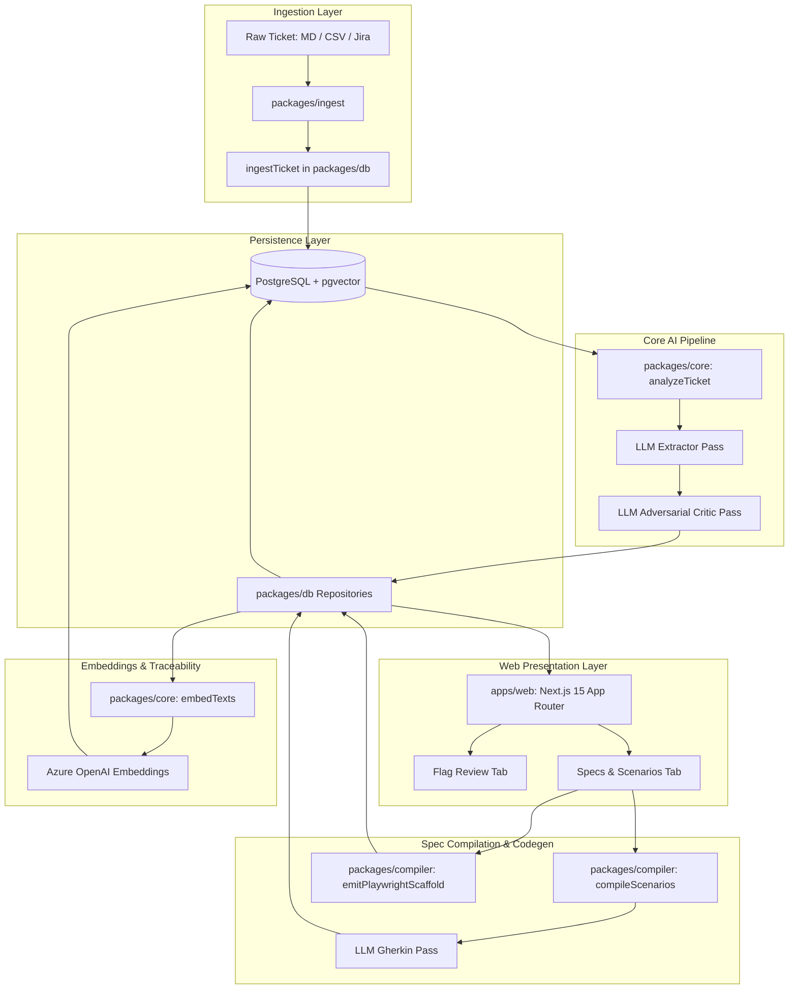
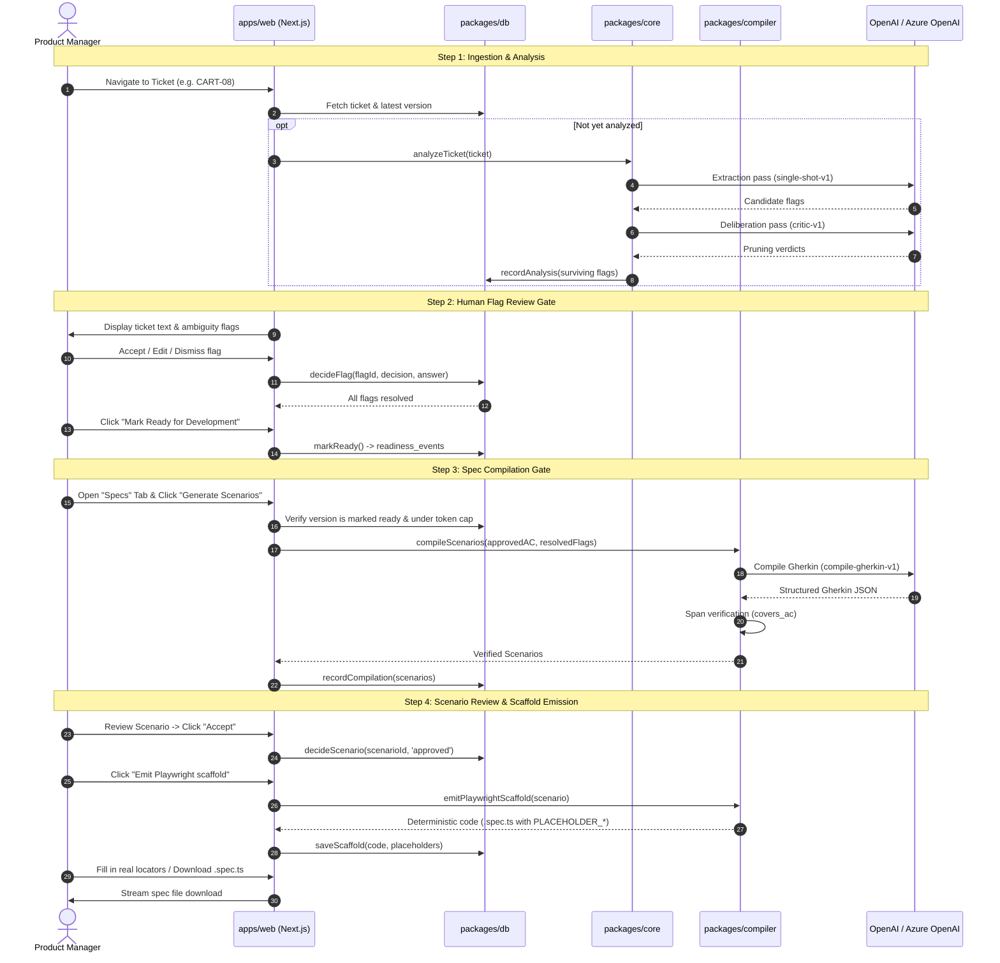

# 02 — Architecture

## 1. System Architecture Diagram

The SpecFix application follows a layered monorepo architecture:

---

## 2. Package Responsibilities & Boundaries

### 1. `apps/web` (Web Application)
* **Role:** Presentation and user workflow coordination.
* **Responsibilities:**
  * Displays ticket queues, ambiguity flags, readiness timelines, and scenario reviews.
  * Server actions handle user decisions and invoke compiler codegen.
  * Reaches database strictly via `apps/web/lib/repos.ts` (which re-exports `@specfix/db` behind `'server-only'`).
* **Constraints:** Must not execute direct SQL queries; all operations are scoped by `tenantId`.

### 2. `packages/core` (AI & Transport Engine)
* **Role:** Provider abstractions, model execution, cost accounting, and embeddings.
* **Responsibilities:**
  * Provider factory (`getClient()`) supporting standard OpenAI and Azure OpenAI.
  * Defensive prompt formatting and structured output parsing (`callStructured`).
  * Token cost estimation and pricing dictionary (`costUsd()`).
  * Batch embedding transport (`embedTexts()`, `embedTextsTolerant()`).
* **Constraints:** Completely stateless with respect to the database. Does not import `@specfix/db`.

### 3. `packages/compiler` (Spec Compiler & Test Emitter)
* **Role:** Generates Gherkin scenarios and emits Playwright test skeletons.
* **Responsibilities:**
  * `compileScenarios()`: Calls LLM with approved requirements and clarifications, parses with `GherkinCompileResultSchema`, and validates `covers_ac` spans.
  * `emitPlaywrightScaffold()`: Deterministic codegen transforming parsed Gherkin steps into TypeScript Playwright test files with `PLACEHOLDER_*` locators.
* **Constraints:** No database dependencies. Returns in-memory domain models.

### 4. `packages/db` (Data Persistence & Tenancy)
* **Role:** Relational persistence, pgvector operations, and schema migrations.
* **Responsibilities:**
  * Connection pooling with SSL handling (`client.ts`).
  * Schema migrations runner (`migrate.ts`).
  * Repositories enforcing tenant isolation (`tenants`, `tickets`, `flags`, `scenarios`, `scaffolds`, `traceability`, `embeddings`).
* **Constraints:** Every repository function takes `tenantId: TenantId` as its first parameter.

### 5. `packages/shared` (Domain Models & Schemas)
* **Role:** Cross-package contracts and validation schemas.
* **Responsibilities:**
  * Zod schemas for analysis results, flags, scenarios, and scaffolds.
  * Gherkin string parsing utility (`parseGherkin()`).
  * Delimiter neutralization helpers.

### 6. `packages/ingest` (Ticket Ingestion)
* **Role:** Raw file parsing and ticket normalization.
* **Responsibilities:**
  * Parses Markdown and CSV formats into `NormalizedTicket`.
  * Sanitizes ticket text to prevent prompt injection.

### 7. `packages/eval` (Evaluation Harness)
* **Role:** Measurement of extraction precision/recall and generation quality.
* **Responsibilities:**
  * Offline scoring against gold-set fixtures.
  * Random-pruning control comparisons.
  * Scenario acceptance and edit-distance metrics.

---

## 3. End-to-End User Workflow Sequence

